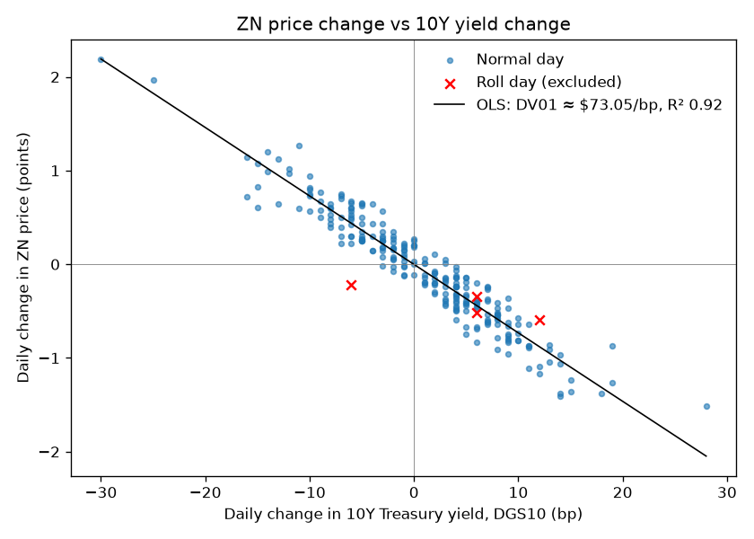
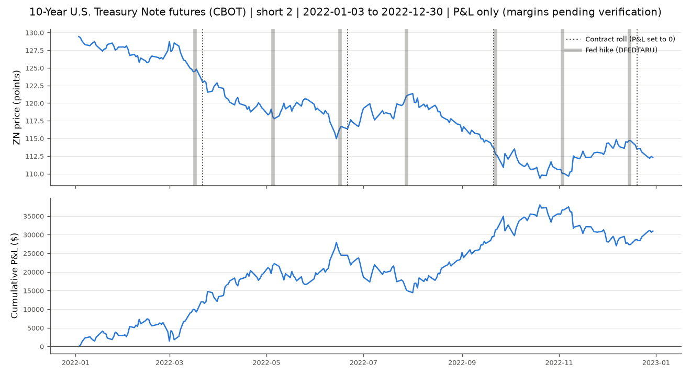

# Treasury Futures P&L and Margin Simulator (10Y T-Note, ZN)

> Simulate a real US 10-Year Treasury Note futures position day by day on real 2022 prices: mark-to-market P&L in points, 32nds and dollars; roll-safe price changes; an empirical DV01 measured against the official 10-year yield; and a margin account driven only by verified CME margin data.

**Data:** every number is sourced in [`data/SOURCES.md`](data/SOURCES.md)

Companion files: [`DECISIONS.md`](DECISIONS.md) (every design choice and the rejected alternatives) · [`FLOW.md`](FLOW.md) (entry points, execution order, call graph)

---

## Table of Contents
1. [Overview](#1-overview)
2. [Background: Treasury Futures](#2-background-treasury-futures)
3. [Tech Stack](#3-tech-stack)
4. [Requirements](#4-requirements)
5. [Project Structure](#5-project-structure)
6. [Architecture and Data Flow](#6-architecture-and-data-flow)
7. [Implementation](#7-implementation)
8. [How to Run](#8-how-to-run)
9. [Design Decisions and Trade-offs](#9-design-decisions-and-trade-offs)
10. [Validation and Sanity Checks](#10-validation-and-sanity-checks)
11. [Results](#11-results)
12. [Limitations](#12-limitations)
13. [Possible Extensions](#13-possible-extensions)
14. [References](#14-references)

---

## 1. Overview

A command-line simulator that answers:

> *"If I had been long or short N 10-Year T-Note futures through 2022, the year the Fed raised rates from 0.25% to 4.50%, what would my daily P&L, margin balance and margin calls have been?"*

| Market | Exchange | Code | Price source |
|---|---|---|---|
| 10-Year U.S. Treasury Note futures | CBOT (CME Group) | `ZN` (clearing code 21) | Yahoo `ZN=F` via yfinance |

**Inputs:** side (long/short), quantity, start/end date, price source (individual contracts or continuous).

**Outputs:**
- A daily ledger CSV with prices in decimals and in 32nds, the roll-day flag, daily and cumulative P&L, and maintenance/initial margin, balance, margin call and `call_reason`.
- A 3-panel chart: price with roll days and Fed hikes, cumulative P&L, and margin balance with the stepped maintenance line and margin calls.
- A validation scatter of ZN price change against 10Y yield change, with the regression line.
- A summary, a leverage table and a **rate-move table** (P&L for a 1/5/10/25 bp move using the empirical DV01).

---

## 2. Background: Treasury Futures

### 2.1 Treasury notes, coupons and yields
A **Treasury note** is a US government bond lasting 2–10 years. It pays a fixed **coupon** every six months and returns face value at maturity. Its **yield** is the return you earn if you buy at today's price. When market yields rise, an existing note's fixed coupon is less attractive, so its **price falls** until its yield matches the market. **Price and yield move in opposite directions.**

### 2.2 10-Year T-Note futures (`ZN`)
From the CBOT Rulebook Ch.19 and the CME contract specs (see `SOURCES.md`):

| Item | Value |
|---|---|
| Underlying | US Treasury notes with 6½ to 10 years to maturity |
| Contract unit | **$100,000** face value |
| Quote | Points and fractions of points (par = 100) |
| 1 point | **$1,000** per contract |
| Minimum tick | **½ of 1/32 = 0.015625 points = $15.625** |
| Contract months | **Mar, Jun, Sep, Dec** (H, M, U, Z) |
| Settlement | **Physical delivery** of Treasury notes |
| Last trading day | 7 business days before the last business day of the contract month |
| Delivery | Any business day of the contract month; intention notice 2 business days before |

**Key identities**
```
multiplier     = face value / 100              = $1,000 per point
tick value     = tick size × multiplier        = 0.015625 × 1,000 = $15.625
dollar P&L     = Δprice(points) × 1,000 × qty × direction   (direction +1 long, −1 short)
notional       = price/100 × $100,000
```

### 2.3 Points and 32nds
`112-09+` means 112 + 9/32 + ½/32 = **112.296875**. The `+` adds half a 32nd. The ledger shows both forms.

### 2.4 Rolling
Longs can be assigned delivery once the delivery month begins, and shorts must give notice two business days earlier. Speculators therefore **roll** (sell the expiring contract and buy the next one) around the end of Feb, May, Aug and Nov. A continuous series such as `ZN=F` **switches contract** at some point, and on that day the "change" includes the price gap between two different contracts, which is not P&L.

### 2.5 Duration and DV01
**Duration** is the approximate % price change for a 1-percentage-point yield move. **DV01** is the dollar change per contract for a **1 basis point** (0.01%) move. That is how rates traders size risk: P&L ≈ −DV01 × Δyield(bp) × contracts × direction. In this project DV01 is **measured by regression**, never assumed (§10).

### 2.6 Margin and mark-to-market
| Term | Meaning (CME wording in `SOURCES.md`) |
|---|---|
| Maintenance margin | Minimum equity per contract, set by CME Clearing |
| Initial margin | For speculative ("heightened risk profile") accounts: **110% of maintenance** |
| Mark-to-market | Gains and losses settled in cash every day |
| Margin call | If equity falls below maintenance, top up **back to initial** |

### 2.7 Worked example on real data (short 2 ZN, around the March 2022 roll)
Prices come from `ZN=F`. The margin is CME's verified maintenance of **$1,600**, in force on 2022-03-23, so initial is $1,760.
```
2022-03-21  close 123-14   (123.437500)   Δ = −1.375000  → short P&L = +1.375 × 1,000 × 2 = +2,750.00
2022-03-22  close 122-29+  (122.921875)   ROLL DAY: Yahoo switched ZNH22 → ZNM22.
                                          Raw Δ −0.515625 is a contract gap → P&L set to 0
2022-03-23  close 123-04+  (123.140625)   Δ = +0.218750  → short P&L = −0.21875 × 1,000 × 2 = −437.50
Margin check on 2022-03-23: maintenance for 2 = 2 × 1,600 = 3,200; initial for 2 = 3,520.
A call would occur only if equity fell below 3,200, and it would restore 3,520.
```
These P&L numbers are identical to rows 2022-03-21 → 2022-03-23 of `outputs/ledger_ZN_short_2_…_pnl.csv`.

---

## 3. Tech Stack

| Tool | Purpose | Why chosen | Alternatives rejected |
|---|---|---|---|
| Python 3.11 | Language | Standard in quant research | C++/Java: unnecessary |
| pandas / NumPy | Time series, ledger, `merge_asof` | Date alignment and an as-of join built in | Plain lists: error-prone |
| **yfinance** | ZN prices | Free, no key; tests individual months first, then `ZN=F` | CME DataMine, Bloomberg: paid. Nasdaq Data Link continuous futures: discontinued |
| **fredapi** (FRED) | `DGS10` 10Y yield, `DFEDTARU` Fed target | Official Fed H.15 data, free API | Yahoo `^TNX`: not the official series |
| **CME rulebook, specs and margin documents** | Contract terms, margin rules, margin values | The exchange is the source of truth. Read via Wayback captures because cmegroup.com blocks scripts | Broker websites: not official |
| python-dotenv | Loads `FRED_API_KEY` from `.env` | Keeps keys out of code | Hard-coding: leaks keys |
| statsmodels | OLS for DV01 with CI and R² | Reports the uncertainty | `np.polyfit`: no CI |
| pdfplumber / openpyxl | Read CME PDFs / advisory `.xlsx` | Pure Python, reliable text extraction | tabula: needs Java |
| matplotlib | Static PNG charts | Embed in the README | Plotly/Streamlit: an extension |
| argparse | CLI | Standard library | Click/Typer: extra dependency |
| pytest | 33 tests incl. provenance | Proves the maths and the data trail | unittest: more boilerplate |

Deliberately not used: backtesting frameworks (they hide the mechanics) and databases (CSV is enough). Full reasoning in [`DECISIONS.md`](DECISIONS.md).

---

## 4. Requirements

### 4.1 Functional
| ID | Requirement |
|---|---|
| FR1 | Download daily ZN prices: individual contract months if available, else `ZN=F` |
| FR2 | Long or short, any integer quantity ≥ 1 |
| FR3 | Roll-safe daily P&L: the change from t−1 to t always uses one contract; roll gaps never enter P&L |
| FR4 | Validate against FRED `DGS10`; estimate the empirical DV01 |
| FR5 | Margin timeline from verified CME documents only; **refuse to run** if any day is uncovered |
| FR6 | Margin call when balance < maintenance × qty; top up to initial × qty; record `call_reason` |
| FR7 | Ledger CSV (decimals + 32nds), 3-panel chart, validation scatter |
| FR8 | Summary, leverage table, rate-move table (1/5/10/25 bp) |
| FR9 | `--pnl-only` mode that produces P&L without reading any margin value |

### 4.2 Non-functional
| ID | Requirement |
|---|---|
| NFR1 | Reproducible: every download cached in `data/raw/` and never re-downloaded |
| NFR2 | Specs and rules held in sourced CSVs (`data/*.csv`), not scattered constants |
| NFR3 | No invented numbers: provenance test fails if any input lacks a source |
| NFR4 | Accounting identity `balance == deposited + cum_pnl` asserted every day |
| NFR5 | Runs in seconds after the first download |

### 4.3 Environment
Python ≥ 3.10, internet for the first download, and a free FRED API key in `.env` (`FRED_API_KEY=...`). Packages are listed in `requirements.txt`: pandas, numpy, yfinance, fredapi, python-dotenv, requests, pdfplumber, matplotlib, statsmodels, pytest, openpyxl.

---

## 5. Project Structure
```
margin-simulator/
├── README.md  DECISIONS.md  FLOW.md  requirements.txt  .env (git-ignored)  .gitignore
├── config/
│   ├── settings.py           # paths, default dates, FRED key loader
│   └── contract_specs.py     # loads + cross-checks data/contract_specs.csv
├── data/
│   ├── SOURCES.md            # provenance of every number
│   ├── contract_specs.csv    # ZN specs with CME quotes
│   ├── margin_rules.csv      # 110% rule, top-up-to-initial rule
│   ├── margins.csv           # ZN maintenance margins (advisory + snapshot rows)
│   └── raw/                  # cached downloads + CME documents (git-ignored)
├── quotes.py                 # to_32nds / from_32nds
├── data_loader.py            # yfinance download, cache, contract probe, quality report
├── fred_loader.py            # DGS10, DFEDTARU, Fed hike dates
├── rolls.py                  # contract calendar, roll detection, roll-safe changes
├── validation.py             # correlation, empirical DV01, scatter
├── margins.py                # merge_asof timeline + verification gate
├── simulator.py              # daily MTM / margin state machine; pnl_path
├── report.py                 # summary, leverage table, rate-move table
├── plots.py                  # 3-panel chart
├── pipeline.py               # glue used by main and tests
├── main.py                   # CLI entry point
├── import_advisories.py      # CME advisory .xlsx → verified margins.csv rows
├── outputs/                  # ledgers, charts
└── tests/                    # 33 tests
```

---

## 6. Architecture and Data Flow
```
 CLI args → main.py → pipeline.prepare
                         │
     ┌───────────────────┼──────────────────────────┐
     ▼                   ▼                          ▼
 contract_specs     data_loader (yfinance)      margins (merge_asof)
 (CME CSV, checks)  → rolls (calendar,          + margin_rules (1.10)
                      volume-jump roll days,    → GATE: refuse if any day
                      roll-safe changes)           lacks a verified margin
                         │
                         ▼
             fred_loader (DGS10) → validation (corr, DV01)
                         │
                         ▼
                  simulator (daily loop, identity asserted)
                         │
              ┌──────────┴───────────┐
              ▼                      ▼
         report (summary,        plots (3 panels,
         leverage, rate-move)    Fed hikes from DFEDTARU)
```
The function-by-function call graph is in [`FLOW.md`](FLOW.md).

---

## 7. Implementation

**Setup.** `python -m venv .venv`, activate it, `pip install -r requirements.txt`, then put `FRED_API_KEY=...` in `.env`.

**Contract specs** (`data/contract_specs.csv`, `config/contract_specs.py`). Each row has the CME source, archived copy, as-of date and quoted text. `load_spec()` derives the multiplier as face/100 and asserts `tick_size × multiplier == tick_value` (0.015625 × 1,000 = 15.625).

**32nds helpers** (`quotes.py`). `to_32nds(112.296875) → "112-09+"` and `from_32nds("110-16+") → 110.515625`. The conversion counts half-32nds as integers so float noise cannot create invalid quotes.

**Prices** (`data_loader.py`). `probe_contracts()` tries `ZNH22.CBT…ZNH23.CBT`; all return no data because Yahoo deletes expired months. It then falls back to `ZN=F`. `quality_report()` returned 251 rows, 0 duplicates, 0 NaN and 0 outliers above 5σ. The 9 missing business days are all US holidays.

**FRED** (`fred_loader.py`). `DGS10` and `DFEDTARU` are cached. Hike dates are where `DFEDTARU.diff() > 0`: 2022-03-17, 05-05, 06-16, 07-28, 09-22, 11-03 and 12-15.

**Rolls** (`rolls.py`). `contract_calendar()` derives each contract's first intention day, first delivery day and last trading day from the CME rules. `detect_roll_days()` finds the day `ZN=F` switched contract (volume ≥ 10× the previous day, inside the roll window). `continuous_changes()` sets those days' change to 0. `stitched_changes()` is the individual-contract path: the change always uses the contract held overnight.

**Validation** (`validation.py`). Align closes and yields on common dates, then compute the correlation and the OLS fit `dP = a + b·dY`. DV01 = −b/100 × $1,000 and duration = −b/avg price × 100.

**Margins** (`margins.py`). `margin_timeline()` uses `pd.merge_asof(direction="backward")` on advisory rows and raises `MarginGateError` if any day is uncovered or unverified. `check_snapshots()` compares the timeline with independent CME snapshots.

**Simulator** (`simulator.py`). This is the daily state machine:
```python
daily_pnl = direction * change * multiplier * qty          # change = 0 on roll days
balance  += daily_pnl
if balance < maint_per_contract * qty:                     # breach
    call = init_per_contract * qty - balance               # top up to INITIAL
    call_reason = "margin_hike" if (balance >= yesterday's maintenance and maintenance rose) else "price_move"
assert balance == deposited + cum_pnl                      # every day
```

**Report, plots and CLI** (`report.py`, `plots.py`, `main.py`).

**Tests** (`tests/`). See §10.

---

## 8. How to Run
```bash
# P&L, validation and rate-move table (reads no margin value)
python main.py --side short --qty 2 --pnl-only
python main.py --side long  --qty 2 --pnl-only

# Full margin simulation (runs once every 2022 day has a verified CME margin)
python main.py --side short --qty 2 --start 2022-01-03 --end 2022-12-30 --price-source continuous

# Import CME advisory spreadsheets saved to data/raw/cme/advisories/
python import_advisories.py

# Tests
python -m pytest -q
```
Outputs go to `outputs/`. Without verified margins, the full run prints `REFUSED: … have no VERIFIED CME margin` and exits with code 2. That is intended.

---

## 9. Design Decisions and Trade-offs

Summary only. The full reasoning and rejected alternatives are in [`DECISIONS.md`](DECISIONS.md).

| # | Decision | Chosen | Alternatives | Why |
|---|---|---|---|---|
| D1 | Data source | Individual months first, `ZN=F` fallback | Paid vendors | Yahoo removed the expired 2022 months (404); `ZN=F` is free and complete |
| D2 | MTM price | Yahoo daily close | Official CME settlement | Settlement history is paid (DataMine); documented in §12 |
| D3 | Frequency | Daily | Intraday | Margin is settled daily |
| D4 | Contract specs | CBOT rulebook + CME specs (archived copies) | Memory or broker pages | Exchange is the source of truth; cross-checked in code |
| D5 | Roll detection | Volume jump inside a CME-rule window | Price residual vs DGS10 alone | `ZN=F` switches on the last trading day; 2 of the 4 2022 roll gaps were smaller than the residual noise (§10) |
| D6 | Roll-day P&L | Set to 0 | Back-adjust; model the move | Never books a fake gain; uses observed data only |
| D7 | Validation | FRED `DGS10` correlation | None | Independent official check |
| D8 | DV01 | Empirical OLS slope | Textbook or CTD duration | No assumed numbers; CI reported |
| D9 | Margins | CME advisories only, with a refuse-to-run gate | Illustrative or broker numbers | Margin calls must be real or absent |
| D10 | Initial margin | 1.10 × maintenance | 1.00× | CME HRP rule for speculative accounts |
| D11 | Margin in force | `merge_asof` backward | Manual loops | Exactly "last rule effective on or before d" |
| D12 | Call top-up | To initial | To maintenance | CME rule (quoted) |
| D13 | Call cause | `margin_hike` / `price_move` | One label | Separates market risk from exchange action |
| D14 | Simulation style | Explicit loop + daily identity assert | Vectorised | Path-dependent state machine |
| D15 | Interface / charts / tests | argparse / matplotlib / pytest | Click, Plotly, unittest | Standard library or simplest tool |

---

## 10. Validation and Sanity Checks

| Check | Result (2022) |
|---|---|
| Tick identity `0.015625 × 1,000 = 15.625` | Pass (test) |
| Multiplier `100,000 / 100 = 1,000 = CME "$1,000 per point"` | Pass (asserted at load) |
| Data quality | 251 rows, 0 duplicates, 0 NaN, 0 outliers > 5σ; 9 missing days = US holidays |
| Roll days detected | **4**: 2022-03-22, 06-21, 09-21, 12-20, which are exactly the CME last trading days of ZNH22/M22/U22/Z22 |
| Correlation ΔZN vs ΔDGS10 (non-roll days, n = 244) | **−0.959** |
| OLS slope | **−7.305 points per 1 pp** (95% CI −7.580 to −7.030), R² **0.919** |
| Empirical DV01 | **$73.05 per bp per contract** (95% CI $70.30–$75.80) |
| Implied duration (average price 118.78) | **6.15** |
| Long = −Short | Pass (test and real runs: ±$30,937.50) |
| Accounting identity | Asserted every simulated day |
| Fake roll gap gives 0 P&L | Pass (3-day test) |
| Margin gate | Refuses unverified, missing and snapshot-only margins (tests) |
| Provenance | Every spec, rule and margin row has a CME URL and date and is listed in `SOURCES.md` (test) |

**Why the volume rule and not the residual rule:** the price residual from the DGS10 regression on the four switch days was −0.08, +0.09, −0.65 and +0.28 points, against a residual standard deviation of 0.17. A residual test catches only the September roll, while the volume ratio on the four days was 1,770×, 1,770×, 723× and 2,981×.

**What the DV01 means:** for each 1 bp rise in the 10-year yield, one ZN contract lost about $73 in 2022. A 6.15 duration means a 1-percentage-point rise in yield cost about 6.15% of the contract's value. The figure ties ZN to the on-the-run 10-year yield, while the contract itself prices off a shorter cheapest-to-deliver note, so the slope is the practical "futures per benchmark-bp" sensitivity a trader uses.



---

## 11. Results

All numbers below come from `python main.py --side {short,long} --qty 2 --pnl-only` on 2022-01-03 → 2022-12-30, `ZN=F`, with 4 roll days neutralised.

```
Contract: 10Y T-Note futures (ZN) | Qty: 2 | Period: 2022-01-03 → 2022-12-30
Entry price  129.437500 (129-14)       Exit price  112.296875 (112-09+)
Underlying % change: −13.24%           Notional at entry (2 contracts): $258,875.00

                         SHORT 2              LONG 2
Total P&L               +$30,937.50          −$30,937.50
Worst day               −$4,375.00           −$3,031.25
                        2022-11-10           2022-06-13
Best day                +$3,031.25           +$4,375.00
                        2022-06-13           2022-11-10
Peak cumulative P&L     +$38,000.00 (2022-10-20, short)
Max drawdown from peak  −$13,468.75 (short)
```

**Rate-move table** (empirical DV01 $73.05/bp, 2 contracts):

| Yield move | Long P&L if yields rise | Short P&L if yields rise |
|---|---|---|
| 1 bp | −$146.10 | +$146.10 |
| 5 bp | −$730.50 | +$730.50 |
| 10 bp | −$1,461.00 | +$1,461.00 |
| 25 bp | −$3,652.49 | +$3,652.49 |



**Interpretation.** Through 2022 the Fed hiked seven times (gray bands) and ZN fell from 129-14 to 112-09+. Short notes was the right trade: +$30,937.50 on 2 contracts. The path was not smooth, though. The short gave back $13,468.75 from its October peak. The single worst day was 2022-11-10: the 10-year yield fell **30 bp** (DGS10) and ZN rallied 2-06 (2.1875 points), costing $4,375 in one session. That's consistent with the DV01: 30 × $73.05 × 2 ≈ $4,383. The biggest gain (+$3,031.25 on 2022-06-13) came on a **+28 bp** yield day. The total P&L is about $34,281 of raw price change, minus $3,343.75 removed on the four roll days (1.671875 points × $2,000), which were calendar spreads, not P&L.

**Margin results (calls, deposits, return on margin, leverage): pending.** The full margin run is blocked by design until every 2022 day has a verified CME maintenance margin (see §12, item 3 and `data/SOURCES.md` §4). Two official CME snapshots are recorded as cross-checks: ZN maintenance **$1,525** (2021-07-08) and **$1,600** (2022-03-23).

---

## 12. Limitations
1. **Yahoo close, not CME settlement.** Exchange mark-to-market uses the official settlement price. Yahoo's daily close is a free proxy and is not official.
2. **Continuous-contract caveats.** Yahoo has no 2022 individual months, so `ZN=F` is used. It keeps the **expiring** contract through the delivery month (volume falls to a few thousand lots) and switches on the last trading day. A real speculator would have rolled about 3 weeks earlier, so delivery-month days are priced on a thin contract. The four switch days' P&L is set to 0, which drops one real day of movement each time.
3. **Margin history incomplete.** CME published the 2022 interest-rate margin tables only as `.xlsx` advisory attachments, which scripts can't download (HTTP 403) and the Internet Archive did not store. Until they are imported (`import_advisories.py`), the margin simulation refuses to run.
4. **No roll costs, commissions, fees or slippage.**
5. **Daily data only.** No intraday margin breaches.
6. **DV01 is empirical and period-specific.** It depends on 2022's yield level and on the CTD note. It is measured against the on-the-run 10Y, not the CTD.
7. **Business-day calendar.** Contract dates use the US federal holiday calendar; CBOT's calendar differs slightly (e.g. Good Friday). The 2022 last trading days computed this way match all four observed switches.

---

## 13. Possible Extensions
- Add the CTD note and conversion factors to compute a theoretical DV01 and compare it with the empirical one.
- Curve trades: 2s10s (`ZT` vs `ZN`) with DV01-neutral ratios and inter-commodity spread margin credits.
- Forced liquidation if a call is not met within N days.
- Roll the position yourself (calendar-spread cost) instead of zeroing the switch day.
- Volatility-scaled margin model, back-tested against CME's actual advisory changes.

---

## 14. References
- CBOT Rulebook Chapter 19, Long-Term U.S. Treasury Note Futures (6½ to 10-Year): cmegroup.com (archived copy dated 2022-01-31)
- CME Group, 10-Year T-Note futures contract specifications (archived 2021-06-25, 2022-03-12)
- CME Group, Performance Bonds/Margins (archived 2022-05-26)
- CME Clearing advisories, Performance Bond Requirements: Interest Rate Margins (2021–2022)
- Federal Reserve Bank of St. Louis, FRED series DGS10 and DFEDTARU
- John C. Hull, *Options, Futures, and Other Derivatives*: Treasury bond futures, duration
- yfinance: https://github.com/ranaroussi/yfinance · fredapi: https://github.com/mortada/fredapi
